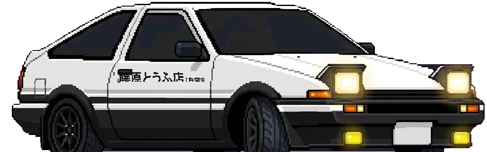

<div align="center">

# 🏎️ Drift86: Initial D Trueno Seekbar
### Toyota AE86 Trueno Drifting Seekbar para Spicetify / Spotify

[](https://github.com/Marce0c0/drift86)
[](https://spicetify.app)
[](LICENSE)

<br/>

<p align="center">
  <a href="https://github.com/Marce0c0/drift86/archive/refs/heads/main.zip">
    
  </a>
  &nbsp;&nbsp;
  <a href="https://github.com/Marce0c0/drift86">
    
  </a>
</p>

> **⭐ Si te gusta este proyecto, dale una estrellita en GitHub arriba a la derecha. ¡Ayuda muchísimo a que más fans de Initial D y Spicetify lo descubran!**

<br/>



</div>

---

## ✨ Características

- **3 Vistas Dinámicas:**
  1. **Pausa (Ángulo 3/4 frontal):** Detenido en la carretera con intermitentes ámbar parpadeando en el morro y trasera.
  2. **Reproduciendo (Cruising lateral):** Vista lateral en carrera con faros pop-up iluminados, sutil vibración de motor y humo de escape suave.
  3. **Derrape (Initial D Drift):** Al arrastrar el cursor o hacer saltos de tiempo, la carretera se curva dinámicamente y el AE86 entra en derrape cruzado con contravolante, humo denso y mini-rebotes de suspensión.
- **Calzada de Tokio (Shutoko C1):** Asfalto oscuro con bordillos dobles y franjas diagonales blancas (chevron) solo en la barra de reproducción.
- **Protección del Slider de Volumen:** La barra de volumen permanece con su diseño limpio original de Spotify, sin alteraciones.
- **100% Autónomo (Standalone):** Todo está empaquetado en un único archivo `drift86.js` con sprites base64 integrados. Sin dependencias externas ni consumo en segundo plano cuando la ventana está minimizada (0% CPU).

---

## 🚀 Instalación Automática (Multiplataforma)

### 🪟 En Windows
1. Descarga el archivo ZIP desde el botón verde de arriba (o clona el repositorio).
2. Descomprime la carpeta y haz doble clic en **`install.bat`**.
3. El instalador configurará Spicetify y te preguntará en pantalla:
   `¿Desea reiniciar Spotify ahora para ver el AE86 de inmediato? (S/N)`
4. ¡Pulsa **S** y listo!

---

### 🐧 En Linux y 🍎 macOS
1. Abre tu terminal en la carpeta descargada.
2. Ejecuta:
   ```bash
   chmod +x install.sh
   ./install.sh
   ```
3. El instalador detectará automáticamente la ruta de extensiones de tu sistema y te preguntará si deseas reiniciar Spotify al instante.

---

### 🌐 Instalación Remota en 1 sola línea (Sin descargar archivos)

#### Windows (PowerShell):
```powershell
iwr -useb "https://raw.githubusercontent.com/Marce0c0/drift86/main/drift86.js" -OutFile "$((spicetify path -e root 2>$null) -replace '[\r\n]','')\drift86.js"; spicetify config extensions drift86.js; spicetify apply; if ((Read-Host "¿Reiniciar Spotify ahora? (S/N)") -match "^[sSyY]") { spicetify restart }
```

#### Linux / macOS (Bash):
```bash
curl -fsSL "https://raw.githubusercontent.com/Marce0c0/drift86/main/drift86.js" -o "$(spicetify path -e root)/drift86.js" && spicetify config extensions drift86.js && spicetify apply && read -p "¿Reiniciar Spotify ahora? (s/n): " r && [[ $r =~ ^[sSyY] ]] && spicetify restart
```

---

### 🛍️ En Spicetify Marketplace (Instalación con 1 Clic dentro de Spotify)
Con el archivo `marketplace.json` incluido, esta extensión es 100% compatible con Spicetify Marketplace. Los usuarios solo buscan **"Drift86"** o **"Initial D"**, pulsan el botón **"Install"**, y Spicetify muestra automáticamente el diálogo emergente para reiniciar Spotify al instante.

---

## 🗑️ Desinstalación

- **Windows:** Doble clic en `uninstall.bat`.
- **Linux / macOS:** Ejecuta `./uninstall.sh`.
- O manualmente en cualquier terminal:
  ```bash
  spicetify config extensions drift86.js- && spicetify apply && spicetify restart
  ```

---

## 🛠️ Compilación para Desarrolladores

Para recompilar `drift86.js` tras modificar sprites o código:
```bash
node build.js
```
*(Requiere únicamente Node.js estándar, sin npm install ni dependencias externas).*

---

<div align="center">
  <sub>Hecho con ❤️ para la comunidad de Initial D y Spicetify. ¡No olvides dejar tu ⭐ en el repositorio!</sub>
</div>
